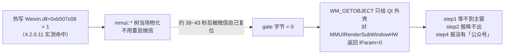
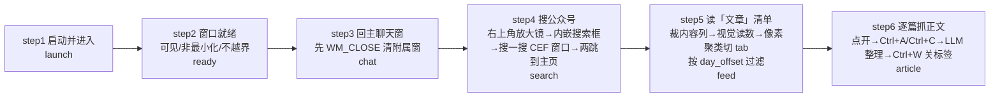

# 微信桌面端 RPA 采集公众号

**一句话原理**：微信没有"列出某公众号文章"的开放接口，公众号主页与文章页还是**自绘 CEF，UIA 读不到内容**。所以走混合路线：**能用 HWND/win32 的绝不问模型**（进程、窗口、矩形、关窗、剪贴板、滚动），**只在"画面语义"上问模型**（现在是什么页面、卡片在哪），模型只回 JSON、不直接操作界面。

**详细设计、全部实测结论与踩坑记录在同目录 `Task-UFO微信.md`（1100+ 行）**，本文件只讲怎么用、什么不能碰。

| 能力 | 状态 | 备注 |
|---|---|---|
| 启动微信并进入主界面（含欢迎页点「进入微信」） | ✅ | 已登录/缩托盘/冷启动三种场景实测 |
| 搜公众号并点开主页（两跳：结果页→账号列表→主页） | ✅ | 每跳判页面类型，不假设跳数固定 |
| 主页「文章」分项清单 + 按天过滤 | ✅ | 默认只读当前屏；按时间窗口要开 `--feed-fill-window` |
| 逐篇点开抓正文（剪贴板路线） | ✅ | 实测 5563 字原文 → 4550 字 / 131 段，全程零滚屏，~40s |
| 「视频号」分项 | ⚠️ 默认不采 | 卡片无日期分组，只能 `--tabs 文章,视频号` 按前 N 条取 |
| 图片长文（整版是图） | ❌ | 剪贴板只有「图片」占位，需 OCR，未实现 |
| 多公众号批量 | ❌ | 靠分别跑几遍 + 自己改名保存产物，否则被覆盖 |

---

## 一、第一铁律：微信的 mmui 控件树默认是**关**的，靠热激活打开

**现象**：主界面肉眼完全正常，但 UIA 只有 Qt 空壳（`class=Qt51514QWindowIcon` + `MMUIRenderSubWindowHW` 第一层 0 子节点），`session_count=0` → step1 等不到主窗、step2 报「既不存在也无法唤出」、step4 报「会话列表里没有「公众号」」。

**根因（2026-11-05 定案，见 `Task-UFO微信.md` §11.30）**：`Weixin.dll` 里 Qt `QAccessible` 的运行时 **gate 字节 = 0**。跟启动方式（`Popen`/ShellExecute/`explorer`）、系统读屏标志、残留插件进程、屏幕/DPI、`Ctrl+Alt+W` 全都**无关**（逐项实测排除）。而且**微信会自己把它复位**：`tests/probe_gate_reset.py` 实测复位周期约 **38~43 秒**，复位后 mmui 树还能残留几秒（会看到 `gate=0` 但 `sessions=10`），下一拍才塌成 `sessions=-1`。所以长流程必须持续补，不是"激活一次就完事"。



- 程序已内置自动兜底：`find_main_window()` 读不到会话时调 `maybe_wake_gate()` 补激活（限流：每进程 ≤60 次、间隔 ≥8s，按 ~40s 复位周期定）；`step1_launch()` 两条 `a11y_disabled` 分支先 `wake_a11y()` 再判失败；`find_session_item_deep()`（步骤4 滚会话列表）每轮开头也保活一次——那个循环要 10~20 秒，中途复位会让后面几轮全读不到条目。
- 手动首选：`--stage a11y --hot-gate`（**不关微信**）。`--repair-a11y`（清插件进程 + 杀微信 + 重启）只是最后手段——**重启本身并不能让树出现**（清干净后连续 3 次重启，45 秒连读 0/45 轮可读）。
- **别在自动化跑到一半时重启微信**：重启后 gate 归零，得重新激活。
- 体检 / 激活：

```bash
python -X utf8 wechat_public_account.py --stage a11y            # 只读体检
python -X utf8 wechat_public_account.py --stage a11y --hot-gate # 体检 + 热激活
```

`verdict` 含义：`ok`（可继续）/ `not_running` / `a11y_disabled` / `tree_broken`。判据是「裸 UIA 数 `MMUIRenderSubWindowHW` 第一层子节点 + `session_count`」，不再只认 `mmui::MainWindow` 类名（旧判据会把能用的实例误报成 `a11y_disabled`）。

---

## 二、前置条件

- **Windows**（pywin32 / UIA / 剪贴板，跨不了平台）；微信 4.x 已装（`Weixin.exe` / `WeChat.exe`，程序会按注册表 App Paths → Tencent InstallPath → 常见路径自己找，也可 `--wechat-exe` 指定）。
- **Python 环境**：conda 环境 `ufo`（依赖见 `requirements.txt`，不锁版本）。命令里**只写 `python`**，由激活的环境决定；必须带 **`-X utf8`**，否则 Windows GBK 控制台打印中文会崩。
- **视觉模型端点**（OpenAI 兼容）：配置放**同目录 `.env`**（已 `.gitignore`，模块导入时自动读，不用 source），同名环境变量可覆盖它（**环境变量优先**）。**密钥只在 `.env`，代码里一个字符都没有**：

| 变量 | 默认 | 说明 |
|---|---|---|
| `VL_BASE` | `http://119.84.39.2:11435/v1` | 端点 |
| `VL_MODEL` | `qwen3.8-27b` | 模型名 |
| `VL_KEY` | **无默认** | 只从 `.env` / 环境变量取；缺了就在发请求前抛「缺 VL_KEY：写进 `.env`」。旧版本曾在代码里内置，那份密钥已进 git 历史（`441a1a7`），要彻底作废得轮换密钥 |
| `VL_THINKING` | `0` | 判图不用长推理，默认关（开着会吃掉 `max_tokens` 导致 `content` 为空） |
| `VL_MAX_WIDTH` | `1600` | 发送前缩图最大宽度 |

`.env` 里一行一个 `KEY=VALUE`，`#` 是注释，值两侧引号可选。加载器是标准库实现（`_load_dotenv()`），不依赖 `python-dotenv`。

上手第一步——照模板建 `.env` 再填密钥（`.env` 不入库，`.env.example` 入库）：

```bash
copy .env.example .env          # Windows；macOS/Linux 用 cp .env.example .env
# 编辑 .env，把 VL_KEY 换成自己的密钥，然后确认读到了：
python -X utf8 wechat_public_account.py --stage probe
```

`--stage probe` 会把 `key_set` / `env_file` / `env_keys_loaded` 打出来，一眼看出配置有没有读到（`key_set=false` 就是 `.env` 没建或 `VL_KEY` 还是占位符）。

- 依赖：`requests Pillow pywinauto comtypes pywin32 psutil numpy`。

---

## 三、命令

以下都在**本技能目录**（`SKILL.md` 所在目录）执行；脚本内部用 `__file__` 定位产物目录，不依赖当前工作目录。

```bash
# 0) 环境体检（只读，不点不动）：exe 定位 + 进程/窗口/显示器 + 一次视觉判定
python -X utf8 wechat_public_account.py --stage probe
python -X utf8 wechat_public_account.py --stage a11y

# 1) 一步到位：启动→就绪→回主窗→搜公众号→读清单→抓正文
python -X utf8 wechat_public_account.py --keyword 汽车公社 --days 1 --feed-fill-window --with-article --article-limit 5

# 2) 按时间窗口（最近 2 天）
python -X utf8 wechat_public_account.py --keyword 建约车评 --days 2 --feed-fill-window --with-article --article-limit 5

# 3) 分步跑（排障用）
python -X utf8 wechat_public_account.py --stage launch
python -X utf8 wechat_public_account.py --stage ready
python -X utf8 wechat_public_account.py --stage chat
python -X utf8 wechat_public_account.py --stage search --keyword 汽车公社
python -X utf8 wechat_public_account.py --stage feed --days 1 --feed-fill-window
python -X utf8 wechat_public_account.py --stage article --article-limit 3

# 4) 2→3→4→5 连跑，每步前置判定、不满足回退上一步
python -X utf8 wechat_public_account.py --stage flow --keyword 汽车公社 --days 1

# 5) 只搜不点开 / 只判定不操作
python -X utf8 wechat_public_account.py --stage search --keyword 汽车公社 --no-open
python -X utf8 wechat_public_account.py --scan-timeout 0 --dry-run
```

**退出码**：`0` 成功 / `1` 任一步失败 / `2` 参数错误。**日志走 stderr，stdout 只留最终 JSON**——PowerShell 里 stderr 会显示成红色 `NativeCommandError`，那不是失败，看退出码。

### 关键参数

| 参数 | 默认 | 要点 |
|---|---|---|
| `--stage` | `all` | `all` / `flow` / `launch` / `ready`(别名 `screen`) / `chat` / `search` / `feed` / `article` / `a11y` / `probe` |
| `--keyword` | 空 | 要搜的公众号名，`flow` 必填 |
| `--days` | `1` | 时间窗口：只留 `day_offset < N`。认「今天/昨天/前天/星期X/M月D日/YYYY年M月D日/N小时前/N分钟前」，认不出的**保留**并计 `unknown_date` |
| `--tabs` | `文章` | **默认只采「文章」**；视频号要显式 `--tabs 文章,视频号` |
| `--max-scroll` | `0` | 步骤 5 每分项最多下滚几次，**0=只读当前屏不滚** |
| `--feed-fill-window` | 关 | 窗口没闭合就自动补滚一屏（最多补 6 屏），碰到更早分组立即停。**按时间窗口采集建议必开**——不开常漏采（实测 `--days 1` 今天 2 篇、当前屏只显示 1 篇） |
| `--article-limit` | `5` | 步骤 6 最多抓几篇 |
| `--article-mode` | `clipboard` | `clipboard`=不滚屏一次复制全文（默认）；`auto`=剪贴板失败再逐屏截图；`scroll`=只逐屏截图 |
| `--article-find-scroll` | `-1` | **-1=自动跟随步骤 5 落盘的 `scrolled`**；`0`=强制不滚（只在步骤 5 只取当前屏时够用） |
| `--feed-json` | `out/step5_feed.json` | 步骤 6 吃哪个清单，可跨次复用 |
| `--with-article` | 关 | `all` 模式下步骤 5 之后接步骤 6 |
| `--dry-run` | 关 | 只判定，不启动/不点击/不移动 |
| `--hot-gate` | 关 | 配 `--stage a11y`：热激活 Qt accessibility gate（写 `Weixin.dll` 的 gate 字节=1），**不重启微信**就让 mmui 树物化——首选修复 |
| `--repair-a11y` | 关 | 配 `--stage a11y`：先热激活，失败才「清插件进程 → 杀微信 → 重启」（会关掉正在用的微信；重启本身并不能让树出现） |

---

## 四、流程与产物



产物（都在本技能目录下）：

```
out/step1_launch.json  step2_ready.json  step3_chat.json
out/step4_search.json  step5_feed.json   step6_articles.json  out/flow.json
screenshots/<tag>_<HHMMSS>.png
logs/run_<时间戳>.log
```

**跑多个公众号必须自己改名保存**（`out/step5_feed_<公众号>.json` / `out/step6_articles_<公众号>.json`），否则下一轮直接覆盖；步骤 6 可用 `--feed-json` 指定读哪份。

---

## 五、必守护栏（都是实测踩出来的）

1. **别中途重启微信**（见第一节：重启后 gate 字节归零，mmui 树得重新热激活）。
2. **别裸按 Esc**：微信主窗在非搜索面板下按 Esc 会**直接把窗口关到托盘**。程序里只在 `search_panel` 放行。
3. **别点窗口右上角三个按钮**：程序对模型给的坐标做了 `_is_system_button_zone()` 二次拦截（主窗右上角 90×70）。
4. **进程在但窗口不可见 → 只能唤出，绝不能重复启动 exe**，那会多开并弹登录页。
5. **搜一搜窗口只能按进程名 `WeChatAppEx.exe` 认**，不能按窗口类/标题——Electron 应用（VS Code/豆包）窗口类同为 `Chrome_WidgetWin_*`，标题也可能带"微信"，认错就把 IDE 当结果页白跑 4 轮。
6. **搜一搜窗口微信一失焦就自动关**，必须同一次运行里读完；它还会**跨运行残留**（带着上次的 tab/主页状态），所以搜索前程序会先 `close_residue_windows()`。
7. **喂模型前必须 `content_crop()` 裁到内容列**：整窗喂坐标误差可达 600px，裁后降到 ~50px。裁出的框要加回窗口原点再换算屏幕坐标。
8. **本进程必须是 DPI 感知**（模块导入即 `SetProcessDpiAwarenessContext(PER_MONITOR_AWARE_V2)`）：否则 125% 缩放下"截图坐标"（物理）与"窗口矩形/点击坐标"（逻辑）差 1.25 倍，越靠右下偏越多。
9. **UIA 查询必须把条件交给服务端**：`descendants(control_type="List")` 秒回；无参 `descendants()` 会把微信拖成 CPU 100%、窗口失联。
10. **中文关键词只能走剪贴板粘贴**（`Ctrl+A`+`Ctrl+V`）：`set_edit_text()` 不产生真实输入事件（搜索面板不弹），`send_keys(中文)` 走 IME 被吞。输入后必须读回比对。
11. **点开文章常是"新开标签页"而非新窗口**（同一个 HWND）：收尾必须 `Ctrl+W`，`Alt+Left` 在新标签里没有上一页。真另开独立 CEF 窗口才走 `WM_CLOSE`。
12. **抄正文前先 `_scroll_to_top()`**：CEF 记得同一篇文章上次的滚动位置，不归位会从文末抄起（曾误判成"图片长文"）。
13. **取正文默认不点击**：点正文区 45% 高度常落在配图 → 弹出大图预览、离开文章页、`Ctrl+A` 失效。默认 `no_click → esc_no_click → title_click` 三策略递进。
14. **「置顶」条目不是今天的内容**：置顶卡片没有发布时间，程序借它下面第一个日期分组判日期（`dropped_pinned_older`）。
15. **合集折叠条不是文章**（如「2个内容」「查看全部」），会被 `FEED_CHROME_RE` + 提示词两层挡掉并计入 `dropped_chrome`。

---

## 六、故障对照

| 症状 | 根因 | 处置 |
|---|---|---|
| step1 一直等不到主窗 / step2「既不存在也无法唤出」/ step4「会话列表里没有「公众号」」 | **Qt accessibility gate = 0**（mmui 树没挂上；微信还会自己把它复位），与启动方式/读屏标志/残留进程无关 | `--stage a11y --hot-gate`（不关微信，树当场物化）→ 复查 `verdict=ok`；仍不行才 `--stage a11y --repair-a11y` |
| 托盘唤出后界面正常但 `session_count=0` | MMUI 的 UI 树没建 | 程序自动发 `Ctrl+Alt+W` 两次重建（用户改过微信热键则失效） |
| 点了没反应 / 点错条目，越靠右下偏越多 | 两套坐标系混用（截图=物理像素、窗口矩形/点击=逻辑像素，125% 缩放下差 1.25 倍）；或窗口被别的程序盖住 | 主脚本导入即自动置 `PER_MONITOR_AWARE_V2`，**自己另写探测脚本时也要先置**；程序每轮 `bring_to_front()`，仍异常就手动把微信置前 |
| 模型把结果页读成 IDE / `title=CodeBuddy` | 按窗口类认错窗口 | 已按 `WeChatAppEx.exe` 认窗；自己写探测脚本时照此 |
| 步骤 5 清单少了文章 | 默认 `--max-scroll 0` 只读当前屏 | 开 `--feed-fill-window`（或给 `--max-scroll N`） |
| 步骤 6 报「没能在文章列表里点开这篇」 | 清单里混了折叠条 / 列表位置变了 / 找文章没跟着步骤 5 滚 | 看 `dropped_chrome`；用默认 `--article-find-scroll -1` 自动跟随 |
| 步骤 6 报「没有文章清单」 | 当前 `--days` 窗口内确实没文章 | 加大 `--days` 重跑步骤 5，或 `--feed-json` 指定别的清单 |
| 某篇 `chars=0` 且 `is_image_article=true` | 整版是图的长文 | 需要 OCR（未实现）；可试 `--article-mode auto` 逐屏截图 |
| 模型 `content` 为空 / JSON 被截断 | thinking 吃掉 `max_tokens` | 保持 `VL_THINKING=0`；正文整理默认 8000 tokens 且有 `_salvage_strings()` 抢救 |

---

## 七、和 `tiger_yuanbao` 技能怎么选

| 需求 | 选哪个 |
|---|---|
| 要**逐字原文**、要阅读量等页面字段、要稳定跑批 | **本技能**（微信 RPA，直接读真页面） |
| 只要**当天/近期概览**、要顺带拿到视频号要点、不想开微信 | `tiger_yuanbao`（元宝网页问答，输出是检索还原，非逐字） |
| 已有文章链接，只要正文 | `../article.py`（公开页直接抓，无需登录） |

---

## 八、合规

只采公开内容；控制频率（一次跑一个公众号，别并发多开微信）；正文入库用于内部分析需注意版权边界；RPA 操作真实客户端，存在被风控的固有风险，勿高频轰炸。
